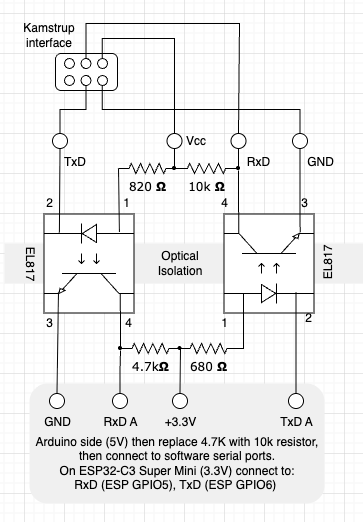
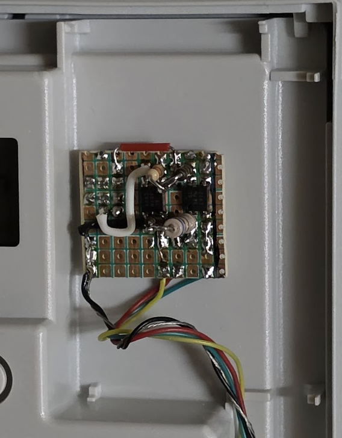
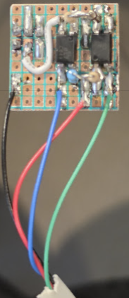
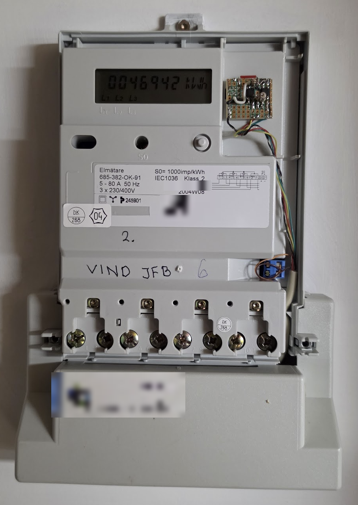
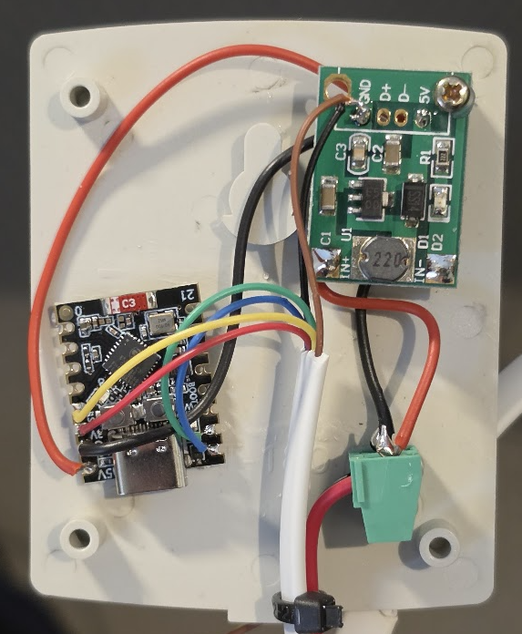
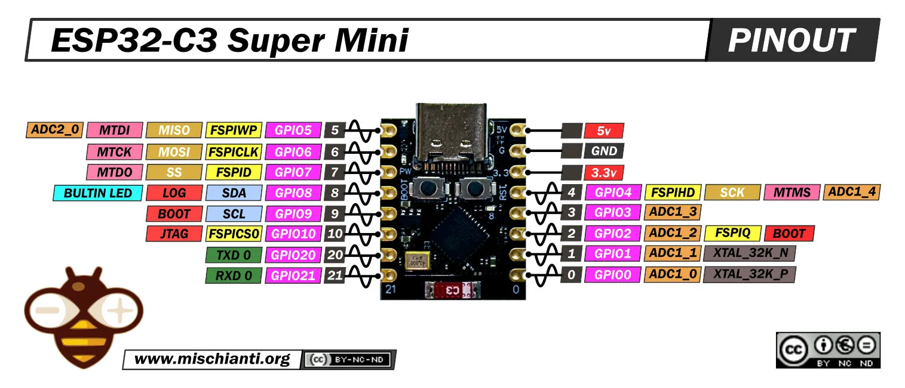

# Kamstrup 382 – ESP32 / ESPHome meter nodes

One standalone ESP32 per Kamstrup 382 electricity meter. Each node reads
instantaneous power from the pulse output and historical/cumulative data over
the IEC 61107 serial interface, then publishes to **MQTT** (on change),
**Home Assistant** (native API), a local **web dashboard**, and a Prometheus
**`/metrics`** endpoint.

See [`kamstrup-esp32-spec-en.md`](kamstrup-esp32-spec-en.md) for the full spec.

## Layout

```
esphome/
  uc1.yaml … uc5.yaml            # one node per meter (identity + board pick)
  secrets.yaml.example           # copy to secrets.yaml and fill in
  prometheus-scrape-config.yml   # example scrape_configs for all 5 nodes
  common/
    kamstrup-base.yaml           # reusable base: uart, iec61107, pulse_meter,
                                 #   api, web_server, prometheus
    board-esp32dev.yaml          # ESP32 DevKit C V4  (board + pins)
    board-esp32c3.yaml           # ESP32-C3 Super Mini (board + pins)
    mqtt.yaml                    # optional MQTT package (add to a node to enable)
  components/iec61107/           # hand-written IEC 61107 parser (external component)
docs/
  pcb-wiring.md                  # netlist + placement for the optocoupler board
  schematic-notes.md             # 3.3V optocoupler wiring notes
  Kamstrup_isolated_IO.png       # schematic (ESP32-C3 / 3.3V version)
  Kamstrup_Arduino_Isolated.drawio  # editable source of the schematic
  *.png, *.webp                  # photos and pinout, see "Hardware" below
  Kamstrup_Interface_IEC61107_comprotocol.pdf   # Kamstrup interface spec
  Kamstrup 382 - Brochure - English.pdf         # Kamstrup meter brochure
```

A node file is tiny — it sets `node_name` / `friendly_name` / `meter_id` and
includes **one** board package plus the base. To move a meter to a different
board, swap the one `board:` include line. Thresholds, read interval and pins
are all substitutions you can override per node.

## Boards

Both are supported; pick per node.

- **ESP32 DevKit C V4** (`board-esp32dev.yaml`) – most headroom, dedicated
  hardware UART for the meter, dual-core. Default for UC1/UC2.
- **ESP32-C3 Super Mini** (`board-esp32c3.yaml`) – small/cheap/low-power, USB
  Serial/JTAG keeps the UART0 pins free (meter UART is on GPIO5/6). Default for the Nibe node, UC4 and UC5.

Serial (USB) logging is **disabled by default** (`logger: baud_rate: 0`) so it
never competes for pins; logs remain available over the network and web UI.

## Hardware

Each node is an ESP32 plus a small isolated interface board on the meter's
6-pin module connector. Details (netlist, placement, polarity, pulse wiring) are
in [`docs/pcb-wiring.md`](docs/pcb-wiring.md) and
[`docs/schematic-notes.md`](docs/schematic-notes.md).

**Isolation schematic** (2x EL817, ESP32-C3 / 3.3V side; source in
[`docs/Kamstrup_Arduino_Isolated.drawio`](docs/Kamstrup_Arduino_Isolated.drawio)).
The ESP side runs from the board's **3V3** pin, never 5V. On the C3 Super Mini
the meter UART is RX = GPIO5, TX = GPIO6.



**Interface board on perfboard:** the original Arduino version, then the ESP
version.




**Installed in the meter** (the board sits in the meter's module slot):



**ESP and power in the enclosure** (ESP32-C3 Super Mini and a DC-DC step-down
power module):



**ESP32-C3 Super Mini pinout** (pinout image from
[mischianti.org](https://mischianti.org), CC BY-NC-ND). Use the pads marked
`5` and `6` for the meter UART, not the UART0 pins:



## Setup

1. Install ESPHome (`pip install esphome` or the Home Assistant add-on).
2. `cp esphome/secrets.yaml.example esphome/secrets.yaml` and fill it in.
   Generate the API key with `openssl rand -base64 32`.
3. Adjust the board include and pins per node if your wiring differs.
4. From the `esphome/` directory, compile / flash:

   ```bash
   cd esphome
   esphome run uc1.yaml      # first flash over USB, then OTA afterwards
   ```

   Run from `esphome/` so the `components/` external component path resolves.

## Data published per node

Instantaneous (pulse output, 1000 imp/kWh):

| Entity               | Unit | Source                          |
|----------------------|------|---------------------------------|
| Instantaneous power  | kW   | `pulse_meter` (time between pulses) |
| Energy (pulse)       | kWh  | `pulse_meter` total             |

Historical (IEC 61107 readout, default every 30 s):

| Entity          | OBIS    | Unit |
|-----------------|---------|------|
| Meter readout OK | –      | on/off (off after 3 failed polls in a row) |
| Type number     | header  | text |
| Serial number   | 0.0     | text |
| Energy register | 1.20    | kWh  |
| Tariff 1        | 1.20.1  | kWh  |
| Tariff 2        | 1.20.2  | kWh  |
| Hour counter    | 1.31    | h    |
| Pulse input     | 1.26    | –    |
| Peak power      | 1.6     | kW   |
| Last month peak | 1.6*1   | kW   |

## MQTT topics

MQTT is optional per node. Add `mqtt: !include common/mqtt.yaml` under `packages:`
(UC1, UC2, UC4 and UC5 do; the Nibe node does not). It needs `mqtt_broker`,
`mqtt_username` and `mqtt_password` in `secrets.yaml`.

With `topic_prefix: kamstrup/<meter_id>`, ESPHome publishes state at:

```
kamstrup/UC1/sensor/energy-register/state
kamstrup/UC1/sensor/peak-power/state
kamstrup/UC1/sensor/instantaneous-power/state
kamstrup/UC1/text_sensor/serial-number/state
…
```

(ESPHome derives the `<type>/<object_id>` segments from the entity type and
name; it does not emit a bare `kamstrup/UC1/<field>`.) Publishing is throttled
by per-sensor `delta` filters — defaults: power 0.1 kW, energy 1 kWh, hours 1 h.

MQTT discovery is off because Home Assistant is fed via the native API; enable
`mqtt: discovery: true` and drop the `api:` block if you'd rather HA use MQTT.

## Prometheus

Point Prometheus at each node using `esphome/prometheus-scrape-config.yml`
(one target per meter, tagged `meter="UC1"…"UC5"`).

## IEC 61107 component

`components/iec61107/` is a standard ESPHome external component. On each poll it
sends `/?!\r\n`, buffers until `[ETX]` + BCC (timing out after 2 s of silence; a frame takes ~7 s at 300 baud), validates the BCC
(7-bit sum from after `[STX]` through `[ETX]` inclusive), parses the OBIS fields
(handling the decimal-comma and the trailing `)!`), and publishes each as a
sensor / text_sensor. The BCC and parser were verified against the sample frame
in the Kamstrup spec (computed BCC `0x3E` = `>`, matching the document).
